# 基于智慧社区数字化运营系统协同治理研究

# 概要设计说明书

> 文档状态：开题阶段初稿  
> 课题周期：2026年6月—2027年12月  
> 需求基线：《基于智慧社区数字化运营系统协同治理研究_需求规格说明书.md》  
> 设计定位：科技研发课题概要设计

## 文档修订记录

| 版本 | 日期 | 修订说明 |
|---|---|---|
| V0.1 | 2026-07-30 | 依据需求规格说明书、课题任务书及平台通用能力材料形成概要设计初稿 |
| V0.2 | 2026-07-30 | 补充业务中台设计，调整六层架构、章节编号、时序图和任务书映射 |
| V0.3 | 2026-07-31 | 精简业务中台为五项核心能力，并重构身份、空间、活动、合同、评价和数据能力归属 |
| V0.4 | 2026-08-12 | 按最新平台建设方案及需求V0.4补充社区商城、社区团购、积分运营设计，并同步调整平台生态运营、调用流程、数据模型、测试与实施规划 |

# 1. 引言

## 1.1 编写目的

本文档用于说明智慧社区数字化运营系统的总体技术方案、架构分层、核心模块、数据关系、系统集成方式及两项创新技术的实现路线，为后续详细设计、开发实施、测试验证和课题成果总结提供总体设计依据。

本文档回答“系统准备如何实现以及各部分如何协同”，设计深度控制在系统边界、模块职责、技术路线、关键机制和技术选型层面，不展开数据库全部字段、接口详细参数、代码类结构、页面原型和开发任务分解。

## 1.2 设计依据

1. 《基于智慧社区数字化运营系统协同治理研究》立项任务书；
2. 《基于智慧社区数字化运营系统协同治理研究_需求规格说明书.md》；
3. 《平台通用能力》材料；
4. 大光路社区物业及运营功能规划讨论成果；
5. 《智慧社区数字化运营平台建设方案》及项目实施条件；
6. 智慧社区、网络安全、数据安全和个人信息保护相关规范。

## 1.3 设计范围

本设计覆盖：

- 物业服务、平台生态运营（商户、商城、团购、服务与积分运营）、空间资源运营、闲置交易、技能分享、社区活动和数据分析等应用；
- 运营主体、商品服务、交易订单、任务履约和计费支付结算等核心业务中台能力；
- 模型、元数据、动态表单、流程规则和场景模板能力；
- AI语义识别、事件结构化、运维知识图谱、派单辅助和相似案例推荐；
- 数据架构、系统集成、安全、部署、日志监控和研究验证。

本设计不包含自营及联合运营、政府及公共服务、碳普惠运营三个独立业务方向，也不建设大规模物联网平台、复杂供应链平台或金融级清分清算系统。

## 1.4 术语说明

| 术语 | 说明 |
|---|---|
| 业务应用 | 面向居民、物业、商户和运营人员组织完整业务流程的应用模块 |
| 业务中台 | 沉淀运营主体、商品服务、交易订单、任务履约和计费支付结算等公共领域能力的模块层 |
| 平台基础能力 | 为业务应用和业务中台提供权限、流程、规则、表单、消息、文件、审计和调度的技术能力 |
| 业务单据 | 保存服务预约、空间预约、活动报名等场景特有信息的单据 |
| 公共订单 | 统一保存交易主体、订单项、金额、支付和售后等公共交易信息的单据 |
| 模块化单体 | 在一个应用部署单元内按业务域划分独立模块，通过公开接口协同的架构形态 |
| 元数据运行时 | 根据已发布元数据解析业务对象、表单、流程、规则和权限的运行组件 |
| 场景模板 | 对一类场景所需模型、表单、流程、规则、权限和字典的可复用封装 |
| AI结构化 | 将居民自然语言或语音转写结果转换为事件类型、位置、对象等结构化字段 |
| 人机协同 | AI提出识别或推荐结果，由人工在权限范围内确认、修订和负责 |

# 2. 总体设计

## 2.1 系统定位

系统定位为智慧社区数字化运营与协同治理技术验证平台。系统以大光路老旧社区为主要应用场景，以社区商业和综合运营为核心，通过统一业务模型、业务中台和平台基础能力支撑商户入驻、社区商城、社区团购、社区服务、空间资源、社区活动及必要物业服务，并研究模型驱动、低代码动态装配、AI语义识别和运维知识图谱等关键技术。

系统建设采用“平台底座建设 + AI能力增强 + 场景应用验证”的总体路线：

1. 以统一身份、空间和业务对象建立数据基础；
2. 以公共业务能力支撑不同应用的组合复用；
3. 以模型、元数据、表单、流程和规则实现动态装配；
4. 以AI和知识图谱提升事件识别与运维协同；
5. 以大光路真实场景和跨业态模拟场景验证研究成果。

## 2.2 设计目标

- 建立边界清晰、可扩展、可逐步演进的平台架构；
- 实现社区“人、房、事、物、组织”数据及关系统一；
- 避免各业务重复开发主体、商品服务、订单、任务履约及计费支付结算能力；
- 支持业务单据与公共能力组合，保留场景差异；
- 支持通过模板和配置快速建立新项目、新业态和新场景；
- 支持AI结果可校验、知识来源可追溯、业务风险可控制；
- 满足课题系统、软件著作权、论文和研究报告的成果验证需要。

## 2.3 设计原则

1. **模块化优先。** 首期采用模块化单体，按业务域设计边界，不以部署数量体现先进性。
2. **分层能力复用。** 领域对象和公共业务规则由业务中台实现，通用技术能力由平台基础层提供，业务应用通过接口调用。
3. **统一主模型、独立场景扩展。** 公共数据保持统一，场景特有数据由独立业务单据承载。
4. **配置与代码分工。** 频繁变化的表单、流程和规则配置化；安全、金额和一致性逻辑代码化。
5. **事件解耦。** 订单完成、工单完成、配置发布等跨模块后续动作通过可靠事件触发。
6. **AI辅助决策。** AI不直接替代责任主体，不绕过权限和业务规则。
7. **渐进式建设。** 先完成关键闭环和研究原型，再扩展复杂业务与多项目能力。
8. **安全内生。** 权限、隐私、审计和数据隔离作为架构基础能力设计。

## 2.4 总体架构

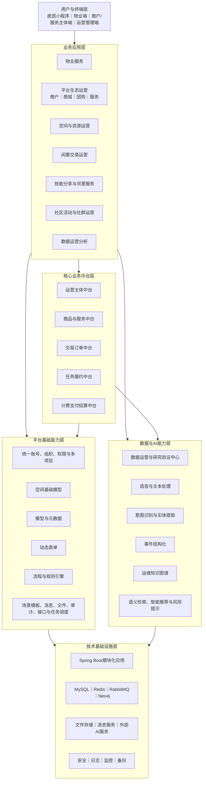

业务应用层负责场景化交互、前置校验和业务编排；五项核心业务中台负责跨应用复用的领域对象、公共状态和一致性规则；平台基础能力层负责统一身份、空间模型、权限、流程、规则、表单、消息和审计；数据与AI能力层负责数据运营、课题指标、语义识别、知识图谱和智能协同；技术基础设施层提供应用运行、存储及外部服务环境。

## 2.5 技术架构

系统首期采用前后端分离、模块化单体、外部服务适配的技术架构。

| 技术层 | 建议选型 | 设计说明 |
|---|---|---|
| 管理端前端 | Vue 3 + TypeScript + Vite | 支撑运营后台、配置中心和研究看板 |
| 移动端 | uni-app | 支撑居民小程序及轻量物业、服务人员应用 |
| 后端 | Java + Spring Boot | 按业务域组织模块并提供统一应用服务 |
| 流程 | Flowable | 支撑工单、审核、资源申请等BPMN流程 |
| 规则 | 轻量规则组件 | 首期可采用Spring表达式或轻量规则引擎，避免建设重量级规则平台 |
| 关系数据库 | MySQL | 保存主数据、业务单据、配置、订单和审计数据 |
| 缓存 | Redis | 保存热点数据、短期状态、幂等标识和分布式协调信息 |
| 消息 | RabbitMQ（按需启用） | 用于支付、订单、AI任务等重要跨模块事件；普通模块内通知不强制经过消息队列 |
| 图数据库 | Neo4j | 保存运维知识实体、关系和图查询 |
| AI适配 | 大模型API + Spring AI适配层 | 统一模型调用、提示模板、结构化输出和降级 |
| 文件存储 | 对象存储或统一文件服务 | 保存图片、语音、附件和知识文档 |
| 部署 | Docker容器化 | 支撑开发、测试和项目现场的一致部署 |

## 2.6 应用形态与模块边界

后端应用建议按以下逻辑模块组织：

```text
community-platform
├─ access-control            统一账号、组织、角色、权限与多项目
├─ space-model              空间树、房屋关系、空间类型与设备位置
├─ property-service         诉求、报修、投诉与物业业务单据
├─ operator-center          运营主体、认证、资质、人员与服务范围
├─ product-service          商品、服务、规格、价格、库存与交易快照
├─ operation-scenario       商城、团购、服务预约、空间预约、活动、闲置与技能场景
├─ points-operation         积分账户、积分规则、积分流水、抵扣与兑换
├─ trade-order              公共订单、订单项、金额、状态与退款申请
├─ fulfillment-task         工单/履约任务、派单、过程、SLA与完成回传
├─ billing-payment          计费、账单、支付、退款、核销、对账与基础结算
├─ lowcode-model            模型、元数据、表单、流程、规则与场景模板
├─ ai-knowledge             AI适配、语义结构化、知识图谱与智能推荐
├─ data-research            数据运营、指标分析与研究验证
└─ platform-support         消息、文件、日志、任务、接口与外部适配
```

模块之间通过应用服务接口和业务事件协同。统一身份和空间属于平台基础模块，不作为独立业务中台；活动、合同、简单权益、评价和风控由相应业务模块或数据与AI模块承接。任何模块不得绕过公开接口直接修改其他模块的数据表。

若未来访问量、团队边界或部署要求发生明显变化，可在保持接口契约不变的前提下拆分部署。

## 2.7 设计边界

- 不以“所有业务共用一张表、一个页面”为统一目标；
- 不将服务预约、空间预约和活动报名等场景差异塞入公共订单；
- 不让公共订单模块了解所有场景的内部处理细节；
- 不让低代码配置绕过身份、权限、金额、支付和审计控制；
- 不让AI直接写入正式工单、正式知识或风险结论；
- 不在课题首期建设服务网格复杂、治理成本高的大规模微服务体系。

## 2.8 两个创新点的总体技术关系

两个创新点并非彼此独立：创新点一负责将业务模型、表单、流程、规则和业务中台能力装配为可运行场景；创新点二在这些场景产生的诉求、工单、巡检、设备和维修数据基础上形成智能识别与知识协同，再将识别和推荐结果返回业务流程。

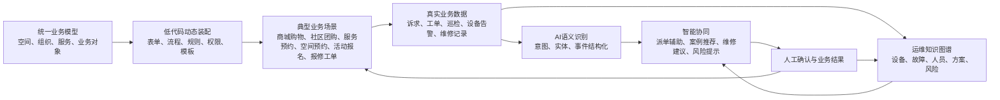

课题验证应同时形成“配置复用证据”和“AI协同效果证据”，避免只完成普通业务功能或只演示脱离业务的AI能力。

# 3. 系统功能架构

## 3.1 业务应用层

| 应用模块 | 主要职责 | 主要复用能力 |
|---|---|---|
| 物业服务 | 房屋居民、报修投诉、巡检问题和工单闭环 | 统一身份、空间模型、任务履约、流程规则、AI |
| 平台生态运营 | 主体入驻、商户管理、商品发布与商城运营、社区团购、服务发布与预约、积分激励 | 运营主体、商品服务、订单、任务履约、计费结算、积分运营能力 |
| 空间与资源运营 | 资源开放、预约、审核、核销和使用分析 | 空间模型、订单、计费支付、流程规则 |
| 闲置交易运营 | 居民发布、审核、撮合、交付和评价 | 商品服务、订单、计费支付、内容审核 |
| 技能分享与邻里服务 | 技能认证、服务发布、预约、履约和评价 | 运营主体、商品服务、订单、任务履约 |
| 社区活动与社群运营 | 活动、场次、报名、收费、签到和社群 | 活动业务模块、空间模型、订单、计费支付、消息 |
| 数据运营分析 | 运营、服务、治理和课题指标分析 | 数据运营与研究验证中心、指标及数据权限 |

## 3.2 核心业务中台层

核心业务中台层精简为五项能力：

1. **运营主体中台：** 统一商户、机构和个人服务者的建档、认证、资质、人员和状态；
2. **商品与服务中台：** 统一类目、商品、服务、规格、价格、库存、时间库存和可售条件；
3. **交易订单中台：** 统一公共订单、交易快照、金额、公共状态、取消和退款申请；
4. **任务履约中台：** 统一工单或履约任务、派单、执行、SLA、异常和结果回传；
5. **计费支付结算中台：** 统一计费、应收账单、支付、退款、核销、对账和基础结算。

中台不等同于后台菜单，也不要求首期独立部署为微服务。只有跨多个业务场景复用且需要统一状态或一致性控制的能力才进入中台。

积分与运营权益作为贯穿商城、团购、服务、活动和空间等场景的横向运营能力建设，负责积分账户、规则、流水、抵扣、兑换和回退，但不单独建设为第六个业务中台，也不在首期建设复杂会员营销平台。

## 3.3 平台基础能力层

平台基础能力包括：

- 统一账号、人员、组织、角色、权限和多项目隔离；
- 空间基础模型、人房关系、空间与设备位置关系；
- 模型与元数据；
- 动态表单；
- 流程引擎；
- 规则引擎；
- 场景模板与组件装配；
- 消息、文件、审计、接口和任务调度。

平台基础能力不承载订单、任务、支付等领域状态机，也不承载大光路特有业务规则。

## 3.4 数据与AI能力层

数据与AI能力层包括：

- 数据运营与研究验证中心；
- 统一指标、专题分析和课题验证证据；
- 语音转写、文本预处理、意图识别和实体提取；
- 事件结构化和补充问题生成；
- 工单、巡检、设备和维修知识抽取；
- 运维知识图谱和关系查询；
- 相似案例、派单建议、维修建议和风险提示；
- AI修订、推荐采纳和结果反馈闭环。

评价汇总、主体风险、重复故障风险和AI效果不再建设独立评价风控中台，而由订单或任务事实、数据分析和AI能力共同承接。

## 3.5 应用与能力协同

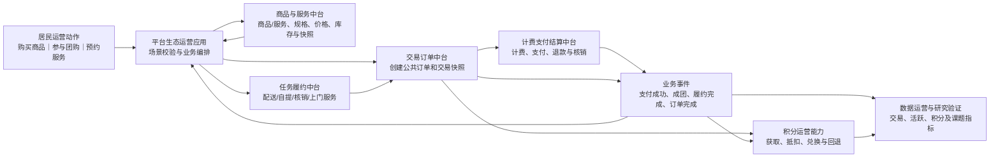

平台生态运营应用负责区分商城购物、社区团购和服务预约等场景特有规则；五项核心业务中台负责主体、供给、订单、履约和支付等公共领域对象；积分运营能力根据订单、履约、活动签到和评价等有效业务事件进行积分发放、抵扣、兑换或回退。前端始终调用场景应用接口，不自行拼接多个中台或积分接口。

## 3.6 研究优先级与建设深度

| 优先级 | 建设内容 | 设计深度 |
|---|---|---|
| P0 | 模型元数据、表单流程规则、场景模板、AI结构化、知识图谱和人机协同 | 完成可运行技术原型、关键机制和验证指标 |
| P1 | 商城购物、社区团购、服务预约、空间预约、活动报名、报修工单 | 完成端到端场景，兼顾核心运营建设与创新技术验证 |
| P2 | 运营主体、商品服务、交易订单、任务履约、计费支付结算，以及统一身份和空间模型 | 建设多个P1场景共同需要的公共能力 |
| P3 | 闲置交易、技能分享、社群、复杂营销和扩展交易 | 以扩展性验证为主，可分阶段实现 |
| 后期拓展 | 街道社区、12345、政务民生、养老、教育、医疗健康等外部服务 | 预留标准接口与统一入口，按合作条件分阶段接入，不作为当前硬性开发要求 |

产品设计和研发排期应围绕P0、P1形成最小验证闭环，不因业务目录较多而削弱两个创新点的资源投入。

# 4. 业务中台设计

业务中台采用模块化领域设计，在同一Spring Boot应用内保持边界，通过应用服务接口和业务事件协同。中台数量不以架构完整为目标，只保留跨业务复用价值明确、具有独立生命周期或一致性要求的五项核心能力。

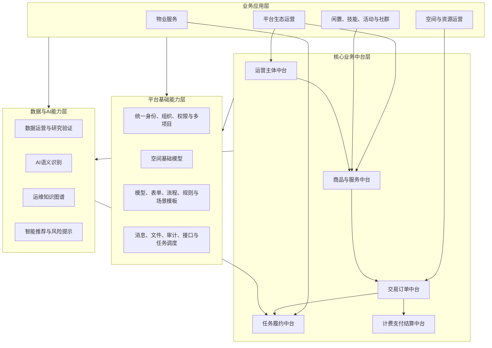

## 4.1 运营主体中台设计

**模块职责。** 统一管理物业组织、商户、服务机构和个人服务者的业务主体信息，为商品发布、订单交易、任务履约和基础结算提供可信主体依据。

**服务边界。** 本中台负责主体建档、认证、资质、服务区域、项目授权、人员关系和主体状态；账号、组织角色及权限归平台基础能力，商品内容归商品与服务中台，资金结果归计费支付结算中台。

**核心领域对象。** 运营主体、主体类型、认证申请、资质、项目授权、服务区域、主体人员关系、主体状态、收款及结算信息引用。

| 对外服务或领域事件 | 设计说明 |
|---|---|
| 主体入驻与认证服务 | 创建主体、提交材料并返回认证结果 |
| 主体资格查询服务 | 判断主体在指定项目、类目和区域内是否有效 |
| 主体人员关联服务 | 维护负责人、商户人员和服务人员关系 |
| 主体状态管理服务 | 管理暂停、整改、退出和限制 |
| OperatorStatusChanged | 主体状态变化时通知商品、订单、任务和数据模块 |

**数据归属。** 主体、认证、资质、服务范围和主体人员关系归本中台；平台账号、角色和权限归统一身份权限模块。

**扩展机制。** 通过主体类型和资质Schema支持机构与个人差异；经营主体、履约主体、收款主体可分别关联。

**建设定位。** 核心建设。

## 4.2 商品与服务中台设计

**模块职责。** 统一管理实物商品、标准服务、预约型服务、居民闲置、技能服务等供给主数据，向业务应用和订单提供规格、价格、库存及交易快照。

**服务边界。** 本中台负责类目、供给、规格、价格、库存、时间库存、服务范围、上下架和快照；不负责公共订单、实际任务过程及空间预约冲突。

**核心领域对象。** 类目、商品、服务、SKU、服务规格、价格、普通库存、时间库存、可售区域、发布主体、上下架状态和业务扩展对象。

| 对外服务或领域事件 | 设计说明 |
|---|---|
| 供给发布服务 | 校验主体资格后创建商品或服务主数据 |
| 可售校验服务 | 返回规格、价格、区域、时间和库存条件 |
| 库存占用与释放服务 | 对普通库存或时间库存执行幂等占用与释放 |
| 交易快照服务 | 为订单生成下单时不可变的供给快照 |
| ProductAvailabilityChanged | 上下架、价格或可售条件变化时发布事件 |

**数据归属。** 商品服务及规格主数据归本中台；订单快照归交易订单中台；预约单和活动报名等场景数据归业务应用。

**扩展机制。** 采用统一供给主模型加业务类型、扩展对象和受控扩展字段。影响检索、价格、库存和履约的字段保持结构化。

**建设定位。** 核心建设；复杂供应链、仓储和促销体系暂不纳入。

## 4.3 交易订单中台设计

**模块职责。** 统一交易公共主数据、订单项、交易快照、金额和公共状态，为计费支付、任务履约、取消、退款及统一查询提供交易依据。

**服务边界。** 本中台不负责空间冲突、服务排班、活动名额和业务审批等场景规则，也不直接处理外部资金。

**核心领域对象。** 平台订单、订单项、金额明细、交易快照、业务关联、公共订单状态、支付状态、履约状态、取消记录和退款申请。

| 对外服务或领域事件 | 设计说明 |
|---|---|
| 创建订单服务 | 接收已通过场景校验的业务单据并创建公共订单 |
| 状态流转服务 | 按合法动作更新公共订单及支付、履约状态映射 |
| 取消及退款申请服务 | 执行公共校验并转交计费支付结算中台 |
| 订单统一查询服务 | 按项目、用户、主体、业务类型和状态查询 |
| OrderCreated/OrderPaid/OrderCompleted | 向场景、任务、评价和数据模块发布状态事件 |

**订单公共模型。** 统一保存平台订单编号、业务类型、交易双方、订单项、订单金额、公共状态、支付状态、履约状态以及创建、取消和完成时间。

**业务扩展模型。** 服务预约单、空间预约单、活动报名记录、闲置交易单和技能服务预约单由各业务应用管理，通过平台订单ID、业务类型、业务单据ID、业务子状态和扩展对象与公共订单关联。

> 中台统一订单公共主数据和公共状态，各业务应用负责特有字段、特有操作、业务详情页面及场景子状态。

**数据归属。** 订单公共数据和交易快照归本中台；业务单据归场景应用；支付、退款、账单和结算明细归计费支付结算中台；任务过程归任务履约中台。

**扩展机制。** 通过业务类型注册场景校验器、快照提供器、状态映射器和完成回调。核心状态及金额不得只保存于JSON扩展数据。

**建设定位。** 核心建设。商城可建设满足一期场景的基础购物车和订单查询能力，但不建设跨商户复杂拆合单、智能拆单和完整大型电商售后平台。

## 4.4 任务履约中台设计

**模块职责。** 统一将物业事件、工单、订单或业务单据转为任务，管理候选人、排班、派单、接单、转派、协同、到场、过程、SLA、异常和完成回传。

**服务边界。** 本中台负责任务执行与闭环；流程引擎负责节点和路径；规则引擎负责候选筛选及自动动作；AI负责推荐，不直接决定责任人；订单金额和支付不属于本中台。

**核心领域对象。** 任务、任务类型、来源业务、执行组织、班组、人员、技能、服务区域、排班、派单记录、过程记录、SLA、异常和完成结果。

| 对外服务或领域事件 | 设计说明 |
|---|---|
| 创建任务服务 | 根据事件、工单、订单或业务单据生成任务 |
| 候选人与派单服务 | 综合区域、技能、排班、工作量和AI建议返回候选并派单 |
| 过程与异常服务 | 记录接单、到场、处理、协同、挂起和异常 |
| 完成与回传服务 | 保存完成结果并回传来源业务及订单状态 |
| FulfillmentStatusChanged | 向业务应用、订单和数据模块发布状态事件 |

**数据归属。** 任务、派单、过程、SLA和完成结果归本中台；物业工单、服务预约单等场景单据仍归业务应用。

**扩展机制。** 按任务类型配置表单、状态映射、SLA和候选规则。物业维修、巡检问题、社区服务和技能服务共用任务接口，但保留场景特有数据。

**建设定位。** 统一任务模型、物业工单、跨场景履约接口、调度机制和AI协同反馈均按本平台需求建设；首期重点满足报修工单及社区服务履约，不追求复杂调度平台。

## 4.5 计费支付结算中台设计

**模块职责。** 统一计费项目、计费规则、应收账单、支付、退款、核销、对账和基础结算，隔离业务应用与外部支付渠道。

**服务边界。** 业务应用决定是否收费以及业务上是否允许取消或退款；交易订单中台负责交易主状态；本中台负责金额形成、资金状态和结算记录；外部支付机构负责实际资金处理。

**核心领域对象。** 收费项目、计费规则、应收账单、账单明细、支付单、退款单、核销记录、渠道流水、收款主体、结算对象、对账记录和结算记录。

| 对外服务或领域事件 | 设计说明 |
|---|---|
| 计费与账单服务 | 根据业务依据生成应收账单和金额明细 |
| 创建支付服务 | 根据订单或账单生成支付受理信息 |
| 支付回调确认服务 | 验签、幂等确认并完成核销及状态通知 |
| 退款服务 | 根据审核结果提交退款并跟踪渠道状态 |
| 对账服务 | 核对业务订单、平台支付单和渠道流水 |
| 基础结算服务 | 按结算对象、周期和简单规则形成结算记录 |
| PaymentSucceeded/RefundCompleted | 向订单、业务应用和数据模块发布结果 |

**数据归属。** 计费规则、账单、支付、退款、核销、对账和结算记录归本中台；商品基础价格归商品与服务中台；交易公共状态归交易订单中台。

**扩展机制。** 采用支付渠道适配器扩展微信等渠道；计费规则通过受控规则配置；商城、团购、服务、空间和活动等收费场景通过统一接口调用。

**建设定位。** 按平台一期交易场景建设基础版本，满足商城、团购、服务、空间和活动的计费、支付、退款、核销、对账及基础结算；首期不建设金融级账户、多级分账、财务总账、跨机构清算和自动开票平台。

## 4.6 中台调用与协同设计

### 4.6.1 调用原则

- 业务应用先完成场景前置校验和必要业务单据创建，再调用中台；
- 前端不直接编排多个中台接口；
- 同步接口用于即时校验和命令，业务事件用于后续通知与最终一致性；
- 跨模块调用携带项目、业务类型、业务单据、调用方和追踪标识；
- 商品库存、团购状态、支付结果、积分流水等重要变化采用幂等、事件记录、重试和补偿机制；
- 中台不得读取或修改其他中台的内部数据表；
- 积分能力只能依据明确业务事件或有审计依据的人工调整发生变动。

### 4.6.2 商户入驻与商品/服务发布时序图

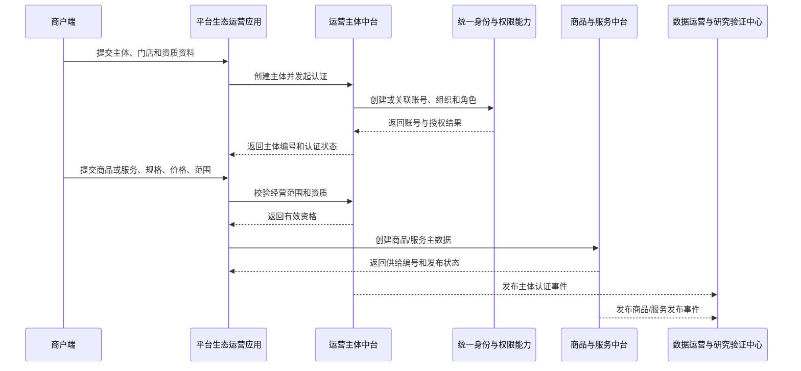

### 4.6.3 社区商城购物时序图

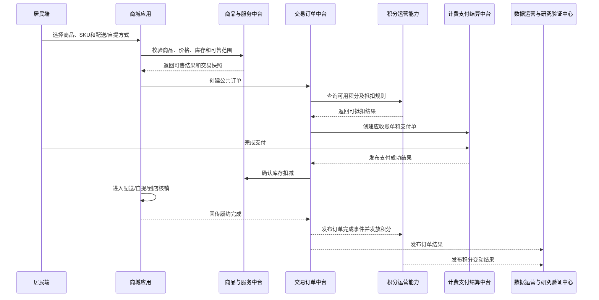

### 4.6.4 社区团购时序图

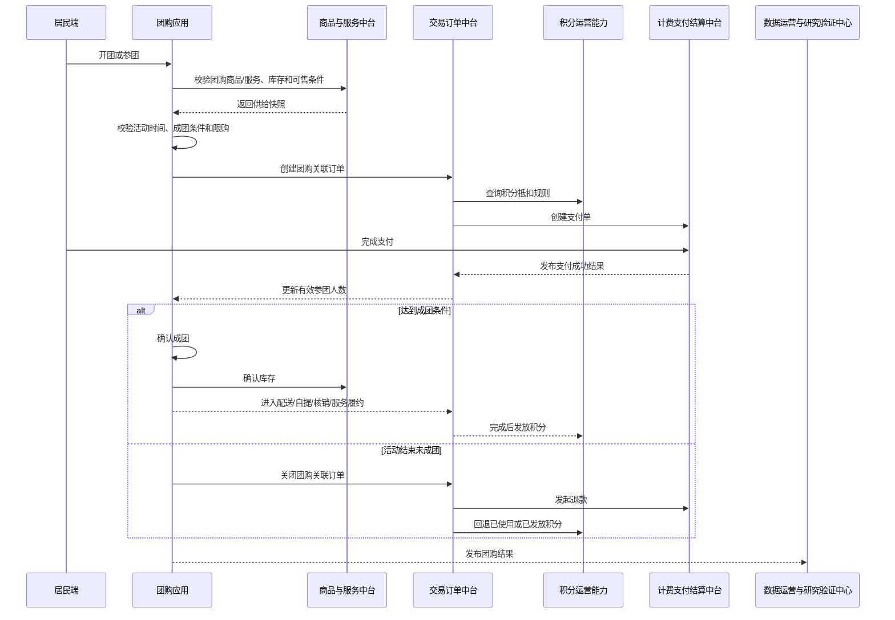

### 4.6.5 社区服务预约与履约时序图

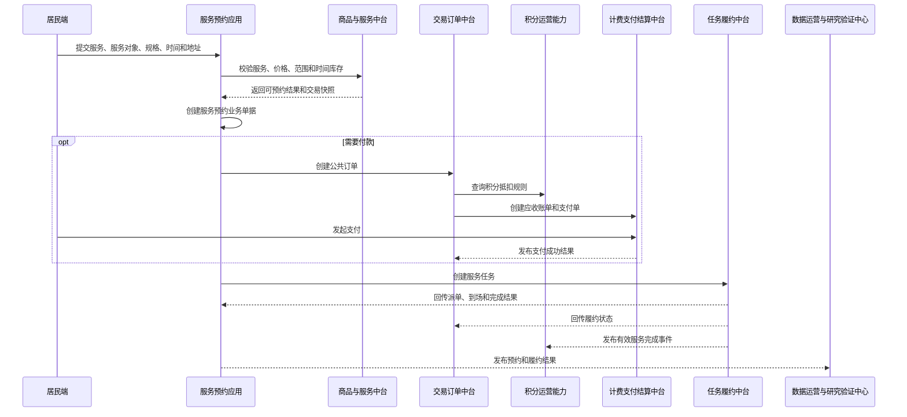

### 4.6.6 空间资源预约时序图

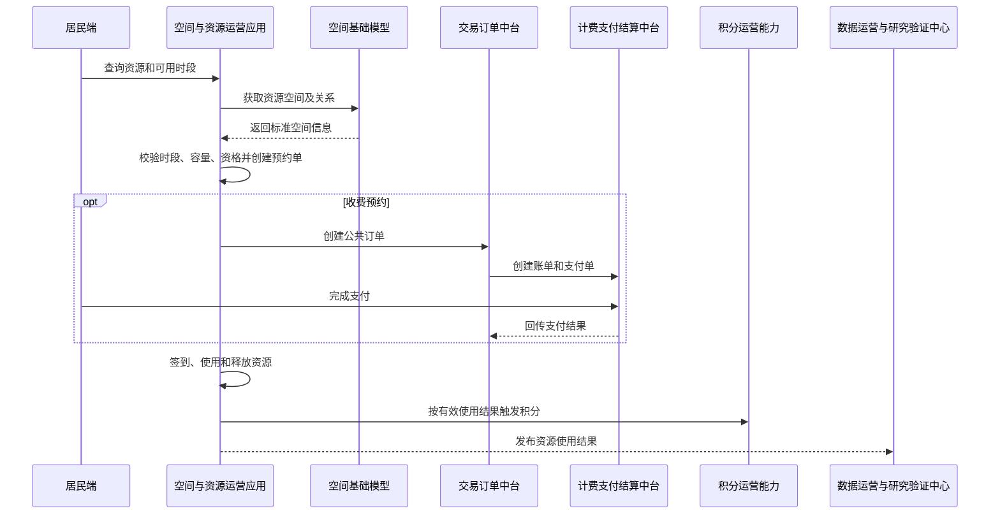

### 4.6.7 非独立中台能力的承接

| 原中台能力 | 调整后的承接方式 |
|---|---|
| 用户与会员 | 统一账号、人员、组织和权限下沉平台基础层；标签归数据分析；基础积分账户与规则由积分运营能力承接；复杂会员等级后续按需扩展 |
| 空间资源 | 空间树和空间关系归空间基础模型；资源开放、预约和使用归业务应用 |
| 活动运营 | 活动、场次、报名和签到归社区活动业务模块；付费时调用订单和计费支付；有效参与可触发积分 |
| 合同 | 在运营主体、商户或空间业务中保留轻量合同档案；如后续对接外部合同系统，通过标准接口集成 |
| 营销权益 | 当前重点建设积分获取、抵扣、兑换和回退；优惠券、会员等级、复杂营销活动后续按需扩展，不建设统一复杂营销中台 |
| 评价与风控 | 评价事实随订单或任务保存；投诉违规由业务应用处理；风险分析归数据与AI能力 |
| 数据运营 | 调整为数据运营与研究验证中心，归入数据与AI能力层 |

## 4.7 业务中台与创新点一的关系

模型驱动与低代码动态装配需要将五项中台能力作为可治理的装配单元。平台建立能力注册目录，定义能力编码、输入输出Schema、权限要求、版本及同步或异步方式；场景模板绑定所需中台能力，配置调用参数、返回结果映射、业务单据关联和扩展对象。

运行时由业务应用根据发布版本编排中台服务。低代码配置不得绕过身份、权限、金额、状态、支付和审计规则，也不得直接操作中台数据表。

## 4.8 业务中台与创新点二的关系

AI语义识别和知识图谱通过统一身份和空间基础模型获取用户、房屋及事件位置，通过运营主体及商品服务中台识别责任主体和服务类型，通过任务履约中台形成处置任务并记录人工选择，通过交易订单和计费支付结算中台获取受控交易上下文，通过数据运营与研究验证中心统计AI应用效果。

AI输出必须经业务规则、中台服务和人工确认后进入正式流程，不能形成孤立的聊天或问答模块。

# 5. 平台基础能力设计

## 5.1 统一身份、组织、权限与多项目能力

### 5.1.1 能力定位

该能力统一管理账号、人员、组织、岗位、角色、项目身份、数据范围和多项目隔离，为业务应用和五项核心业务中台提供认证与授权支撑。它属于平台基础能力，不再建设“用户与会员中台”。

### 5.1.2 核心设计

- 支持自然人、工作人员和运营主体人员的账号映射；
- 支持居民、物业人员、商户人员、服务人员等项目身份；
- 支持用户与房屋、组织、主体及项目之间的有效关系；
- 支持组织树、岗位、角色、菜单、操作和数据权限；
- 支持按项目、组织、空间和对象计算数据范围；
- 支持临时授权、代办授权、到期失效和授权审计；
- 用户标签和画像只用于业务分析，不直接扩大权限。

### 5.1.3 关键边界

平台身份模块负责账号和业务身份关系；运营主体中台负责商户、机构和个人服务主体；基础积分账户、规则和流水由积分运营能力承接，复杂会员等级、优惠券组合和营销自动化不纳入首期核心能力。跨项目访问、敏感查询和批量导出必须显式授权并记录审计。

## 5.2 空间基础模型

### 5.2.1 能力定位

空间基础模型统一描述项目、社区、小区、楼栋、单元、房屋、公共区域、楼宇、楼层和设备位置，为人房关系、事件定位、资源运营和多业态复制提供标准空间语义。它不再作为独立“空间资源中台”。

### 5.2.2 核心设计

- 支持可配置的空间节点类型和层级约束；
- 支持社区、小区、楼栋、房屋，以及楼宇、楼层、房间等不同结构；
- 支持空间节点与用户、组织、运营主体、设备、事件和业务单据关联；
- 支持空间节点调整、合并、拆分、停用和历史留痕；
- 支持平台全新建立房屋和基础空间，并预留后续通过标准接口接入外部空间或房屋数据的能力；
- 对外提供空间解析、关系查询和标准空间选择服务。

### 5.2.3 关键边界

空间基础模型负责“空间是什么以及对象位于哪里”；资源是否开放、如何预约、时段冲突、收费和使用记录归空间与资源运营业务应用；设备协议接入不属于本模块。

## 5.3 元数据与通用对象标识

### 5.3.1 能力定位

元数据与通用对象标识能力为业务模型、动态表单和场景模板提供统一对象类型、字段、关系、版本及全局标识规则，不直接承载订单、空间和任务等领域事实数据。

### 5.3.2 核心设计

- 为模型、表单、流程、规则和中台能力定义稳定编码；
- 管理对象类型、字段类型、关系类型、校验和显示元数据；
- 保存元数据版本、发布状态、依赖关系和变更记录；
- 为跨模块对象引用提供全局对象类型与业务标识；
- 核心领域字段保持结构化，低频扩展字段受Schema约束。

### 5.3.3 关键边界

运营主体、商品服务、订单、任务和账单等事实数据分别归对应业务中台；平台元数据只描述结构和装配方式，不替代领域服务的状态及规则。

## 5.4 业务对象模型

### 5.4.1 模型分层

| 类型 | 示例 | 设计方式 |
|---|---|---|
| 核心标准对象 | 账号、主体、商品服务、订单、任务、支付、权限 | 固定代码和稳定表结构 |
| 场景业务对象 | 服务预约、空间预约、活动报名、闲置交易 | 独立业务单据 + 可配置字段 |
| 轻量扩展对象 | 调研表、补充信息、临时登记 | 元数据驱动动态对象 |

### 5.4.2 统一主模型与场景扩展

服务预约业务单据保存预约时间、地址、服务要求等特有信息；公共订单保存交易双方、订单项、金额和公共状态；任务保存派单和执行过程；账单及支付保存金额形成与资金状态。各对象通过稳定业务标识关联，但保持独立生命周期。

活动报名本身具有独立生命周期：免费活动只产生报名记录，付费活动再关联交易订单。一笔订单可以关联多名参与人的报名记录。

### 5.4.3 状态设计

业务单据状态、订单状态、支付状态和任务履约状态分别管理，通过合法业务动作和事件协同。页面可以聚合展示，但不得用一个状态字段替代不同模块的职责。

## 5.5 动态表单能力

动态表单由字段元数据、布局元数据、校验规则和权限策略组成。设计包括：

- 基础控件、字典、附件、空间选择、人员选择等字段类型；
- 必填、长度、格式、跨字段和远程校验；
- 根据场景、角色和单据状态控制显示与编辑；
- 表单版本绑定业务记录，保证历史数据可解释；
- 核心查询和流程字段结构化存储，低频扩展字段可保存为扩展数据。

前端通过Vue 3动态表单渲染器解释表单Schema，后端根据相同元数据再次校验，避免只依赖前端校验。

## 5.6 流程与规则能力

### 5.6.1 流程能力

Flowable用于承载工单流转、主体审核、资源申请和活动审核等需要节点、角色、时限和退回机制的流程。流程实例绑定发布版本，运行中实例不因新版本发布而无规则改变。

### 5.6.2 规则能力

轻量规则组件用于主体准入、服务范围、预约资格、任务候选、SLA、资源收费、风险分级和消息触达等判断。规则包括适用项目、条件、优先级、生效时间和结果说明。

### 5.6.3 与领域中台的边界

流程负责编排，规则负责判断，领域中台负责最终业务约束。支付签名、订单金额、退款核验、权限校验、数据隔离和任务状态合法性不允许由运营人员自由配置。

## 5.7 场景模板与组件装配能力

场景模板将模型、表单、流程、规则、权限、字典、页面组件和中台能力调用封装为版本化资产。首批模板重点覆盖报修工单、商品发布/商城、社区团购、服务预约、空间预约和活动报名等场景。模板实例化过程包括：

1. 选择模板和目标项目；
2. 检查依赖的业务中台、平台能力和前端组件；
3. 映射目标空间类型、组织角色和服务目录；
4. 设置项目参数和差异化配置；
5. 配置中台调用参数及返回结果映射；
6. 在预览或测试环境执行校验；
7. 发布项目实例并保留模板来源；
8. 后续通过差异比较决定是否接受模板升级。

模板升级不得直接覆盖项目差异。项目扩展以覆盖配置或标准插件模块实现，不复制整套代码。

## 5.8 消息、文件、审计、接口与任务调度

- 消息中心负责模板、接收人和多渠道路由，业务应用或中台决定触发时机及内容；
- 文件中心负责上传、存储、访问控制、安全检查和生命周期；
- 审计日志记录配置、权限、导出、主体审核、订单、任务和支付等关键操作；
- 任务调度负责定时任务、失败重试和补偿执行，不承载领域状态机；
- 接口管理负责外部接口注册、认证、限流、幂等、版本和调用日志；
- 设备接入通过适配接口将告警转为标准事件，不建设完整物联网协议平台。

## 5.9 能力注册与事件协同

平台为业务中台和低代码场景提供统一能力注册目录，登记能力编码、提供模块、输入输出Schema、权限要求、同步或异步方式及版本。场景应用通过应用服务调用中台，中台通过领域事件通知后续处理；前端不直接编排多个中台。

```text
场景应用 → 已注册中台服务 → 领域结果
领域结果 → 业务事件 → 订阅中台或数据与AI能力
平台基础能力 → 身份权限、空间解析、流程规则、消息、文件、审计和失败补偿
```

重要事件采用“业务事务 + 事件记录 + 按需消息投递 + 消费幂等 + 失败重试”的可靠机制；只影响当前模块且允许即时处理的轻量通知可使用应用内事件。

# 6. 数据架构设计

## 6.1 数据架构

数据架构按照“主数据—业务数据—知识数据—分析数据—配置元数据”组织：

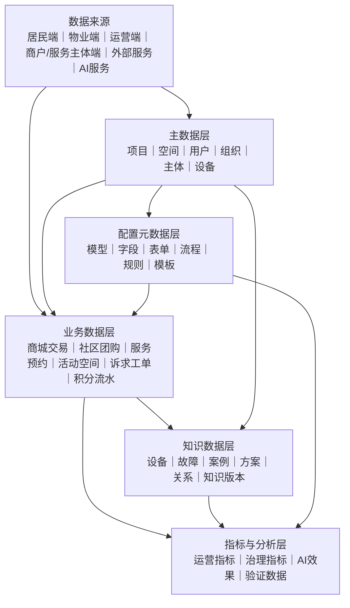

主数据是业务关联的统一标识来源；业务数据记录真实过程；知识数据保存实体关系和知识证据；配置元数据决定业务运行方式；分析数据形成统一指标和课题证据。

## 6.2 核心数据模型

### 6.2.1 “人、房、事、物、组织”模型

- **人：** 自然人、账号、居民身份、家庭关系和服务人员；
- **房：** 项目、空间节点、房屋、公共区域和可运营资源；
- **事：** 居民诉求、社区事件、工单、预约、活动和履约任务；
- **物：** 设备、设施、商品、闲置物品和业务附件；
- **组织：** 物业、社区、平台运营方、商户、服务机构和班组。

### 6.2.2 运营交易模型

运营交易模型包括运营主体、商品或服务、SKU、团购活动与参团关系、服务预约等业务单据、公共订单、订单项、价格快照、支付引用、配送/核销/服务履约任务、售后、评价及积分流水。交易发生时保存快照，避免后续商品、价格、团购规则或主体信息变化影响历史订单。

### 6.2.3 配置模型

配置模型包括模型定义、字段定义、表单Schema、流程定义、规则定义、权限策略、场景模板、项目实例、发布版本和依赖关系。配置模型与业务数据分库逻辑隔离，运行时只加载已发布版本。

### 6.2.4 知识模型

知识模型由实体、关系、属性、来源、可信度、审核状态、有效时间和版本构成。知识来源可以是结构化业务数据、已审核文档或AI候选抽取结果。

## 6.3 核心实体关系

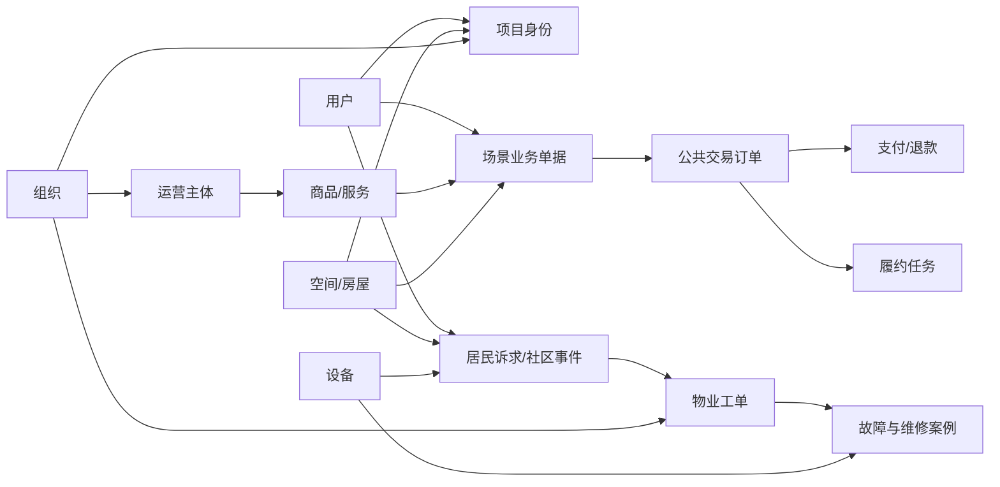

## 6.4 数据关系设计原则

- 业务对象使用稳定ID关联，不以名称和地址作为唯一关联依据；
- 业务单据和公共订单使用业务类型、业务单据ID和订单ID关联；
- 支付、履约、评价与订单保持独立状态和完整记录；
- 图数据库中的业务实体保存源系统标识，能够回查原始记录；
- 历史业务使用发生时快照，主数据变更不反向篡改历史；
- 模板与项目实例保留来源和差异，便于升级影响分析；
- 逻辑删除、停用和失效根据对象类型区分，禁止无依据物理删除。

## 6.5 数据存储方案

| 数据类型 | 存储方案 | 说明 |
|---|---|---|
| 主数据、业务数据、配置元数据 | MySQL | 事务一致性、结构化查询和审计 |
| 缓存、幂等标识、短期锁 | Redis | 不作为唯一业务数据来源 |
| 异步业务事件 | RabbitMQ + 事件记录表 | 保证可追踪、重试和消费幂等 |
| 运维知识关系 | Neo4j | 图关系查询、路径分析和知识关联 |
| 图片、语音和附件 | 对象存储或统一文件服务 | 数据库保存文件元数据和权限 |
| 统计结果 | MySQL统计表或分析视图 | 课题首期不单独建设大数据平台 |

## 6.6 数据流转

业务写入首先落入所属领域模块的事务数据；跨模块变化通过可靠事件传播；AI候选结果先保存为待确认数据，人工确认后再转为正式事件或知识；分析数据从已确认业务结果和统一指标口径生成。

对关键跨模块操作采用最终一致性和补偿机制。例如支付成功但订单状态更新失败时，支付回调保持幂等，补偿任务重新核对支付单和订单状态。

## 6.7 数据权限与生命周期

数据访问按项目、组织、空间和对象权限控制。居民个人信息、语音、图片和导出文件执行最小必要、脱敏和审计要求。业务数据、知识版本和配置发布记录按企业制度和适用法规归档；研究数据原则上脱敏，并记录样本来源和使用范围。

# 7. 核心业务流程设计

## 7.1 居民诉求智能协同流程

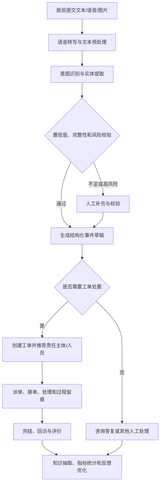

设计要点：

- 保存原始诉求，不用结构化结果覆盖原文；
- AI先形成草稿，由业务规则和人工确认决定正式流转；
- 派单建议说明候选依据，不直接改变工单责任；
- 工单完成后产生知识候选和效果数据，不自动写入正式知识。

## 7.2 平台生态运营核心流程

平台生态运营统一基于运营主体、商品与服务、交易订单、计费支付结算等公共能力运行，并根据商城、团购和服务三类场景保留独立业务规则。积分通过订单完成、有效履约、评价等业务事件进行发放、抵扣和回退。

### 7.2.1 商城购物流程


设计要点：

- 商品、价格、商户和履约方式在下单时保存交易快照；
- 支持满足一期场景的基础购物车，不建设复杂跨商户拆合单；
- 配送、自提和到店核销由场景应用记录结果，订单中台汇总履约状态；
- 退款时按规则处理库存、支付和积分回退。

### 7.2.2 社区团购流程

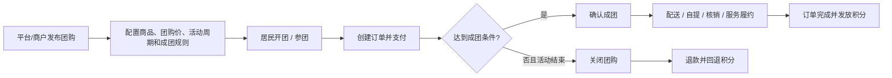

设计要点：

- 团购活动和公共交易订单保持职责分离；
- 首期支持简单人数/数量成团、限时团购和社区集中采购；
- 不建设复杂团长分销和多级返佣体系；
- 成团规则、库存、支付、退款和积分处理均应具备幂等机制。

### 7.2.3 服务预约与履约流程

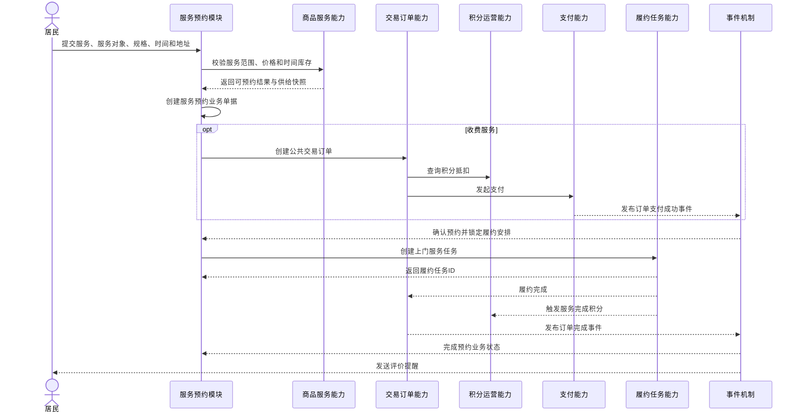

设计要点：

- 服务预约单记录服务对象、时间、地址等特有信息；
- 收费服务才生成公共交易订单，免费服务可仅形成预约单；
- 支持经授权家庭成员作为服务对象，满足助老等场景；
- 取消、改期和退款需联动时间库存、订单、履约任务和积分。

## 7.3 空间资源预约流程

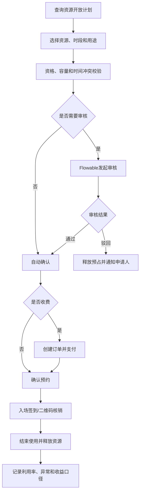

## 7.4 活动报名流程

活动模块维护活动、场次、名额和参与人；空间能力校验场地；免费活动只建立报名记录；付费活动建立报名记录并关联公共订单。报名取消或退款后释放名额并按候补顺序通知。

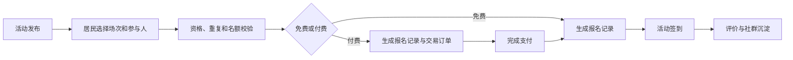

## 7.5 配置发布流程

模型、表单、流程、规则和模板配置经过草稿、静态校验、依赖检查、测试预览、审批发布和运行监控。若发布失败或业务异常，可恢复到上一稳定版本。

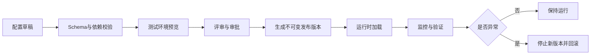

# 8. 创新点一技术方案：模型驱动与低代码动态装配

## 8.1 技术目标

解决不同社区、办公楼和公寓项目重复建模、重复开发和差异难维护的问题。通过统一模型、元数据、动态表单、流程规则和场景模板，使新场景建设从“复制代码”转向“复用能力、配置差异、扩展特有逻辑”。

## 8.2 技术架构

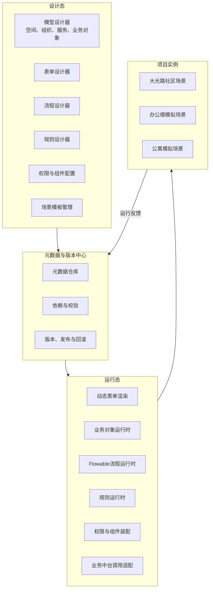

## 8.3 模型体系设计

### 8.3.1 模型元对象

模型元对象包括模型、实体、字段、关系、状态、操作、校验、权限、事件和扩展点。空间模型、组织模型和服务模型是领域模型；表单、流程和规则通过模型标识与领域模型绑定。

### 8.3.2 核心对象稳定原则

统一身份、权限、订单、支付和审计等核心对象采用稳定代码模型。动态模型用于场景单据和项目差异，不允许通过元数据任意改变核心交易语义。

### 8.3.3 场景扩展方式

按复杂度采用三种扩展方式：

1. **配置扩展：** 字段、表单、流程、规则和权限；
2. **业务单据扩展：** 为稳定且有独立生命周期的场景建立独立表和领域逻辑；
3. **插件模块扩展：** 对配置无法表达的复杂业务实现标准接口插件。

## 8.4 动态装配机制

运行时根据项目、场景和发布版本加载元数据，完成：

1. 解析业务对象与表单Schema；
2. 按角色和状态计算字段权限；
3. 绑定Flowable流程定义；
4. 执行业务校验和规则；
5. 装配页面组件和可用操作；
6. 调用用户、空间、订单或履约等业务中台能力；
7. 保存业务数据及元数据版本；
8. 发布业务事件。

运行时元数据采用缓存提高访问效率，发布事件触发缓存更新。旧业务记录保留创建时版本，避免新配置导致历史记录无法解释。

## 8.5 表单、流程与规则实现

### 8.5.1 动态表单

使用JSON Schema思想描述字段、校验和数据结构，并以独立UI Schema描述布局和组件。Vue 3渲染器负责前端展现，Spring Boot后端执行二次校验。

### 8.5.2 流程

使用Flowable设计BPMN流程。业务模块负责启动流程、处理任务和接收流程事件，核心业务状态由领域服务控制，避免流程引擎直接修改所有业务字段。

### 8.5.3 规则

首期使用轻量表达式或规则组件实现条件判断，规则输入使用明确的业务上下文对象，输出包含结果和命中依据。复杂规则在发布前执行样例测试和冲突检查。

## 8.6 场景模板与项目继承

模板版本由基础模型、表单、流程、规则、权限和字典清单构成。项目实例保存：

- 模板来源和版本；
- 项目参数；
- 空间与组织映射；
- 覆盖配置；
- 插件扩展；
- 发布历史。

模板升级时系统计算新增、修改、删除和冲突项，由项目负责人选择接受、保留或合并，不执行无差别覆盖。

## 8.7 配置发布与治理

- 配置在草稿区编辑，不直接影响生产运行；
- 发布前完成Schema、引用、循环依赖、权限和样例数据校验；
- 发布包生成版本摘要和内容哈希；
- 发布操作经过授权和审批；
- 运行时只读取不可变的正式版本；
- 提供灰度或指定项目发布能力；
- 保留上一稳定版本并支持回滚；
- 发布、回滚和紧急停用全过程审计。

## 8.8 技术选型

| 技术环节 | 建议选型 | 选型理由 |
|---|---|---|
| 后端运行时 | Spring Boot | 与现有Java体系一致，适合模块化领域服务 |
| 元数据存储 | MySQL + JSON字段辅助 | 核心结构可查询，扩展配置保持灵活 |
| 表单Schema | JSON Schema思想 + 自定义UI Schema | 便于前后端共享结构和校验约定 |
| 表单渲染 | Vue 3 + TypeScript动态组件 | 支撑配置中心和运行态页面 |
| 流程引擎 | Flowable | 支持BPMN、任务、变量、历史和版本 |
| 规则实现 | Spring表达式或轻量规则引擎 | 满足课题MVP，降低运维复杂度 |
| 缓存 | Redis | 缓存发布元数据和规则结果 |
| 发布事件 | RabbitMQ | 通知运行节点刷新配置并支持可靠重试 |

## 8.9 技术验证方案

选择商品发布/商城、社区团购、服务预约、空间预约、活动报名和报修工单中的代表性场景，验证：

1. 相同公共模型和能力能否支持不同场景；
2. 表单、流程、规则和权限能否通过配置完成；
3. 项目模板能否复制到办公楼或公寓模拟项目；
4. 项目差异能否通过参数和覆盖配置表达；
5. 发布、版本对比、依赖校验和回滚是否有效；
6. 需要新增代码的内容是否集中在明确扩展点。

验证指标沿用需求规格说明书中的场景配置时间、配置覆盖率、公共能力复用率、模板直接复用比例、发布成功率和跨业态适配结果。

## 8.10 创新性说明

创新点不在于单独使用动态表单或Flowable，而在于围绕社区空间、组织、服务和业务对象模型，将元数据、表单、流程、规则、权限、业务中台调用和场景模板形成统一装配链路，并以真实项目复制验证其有效性。

# 9. 创新点二技术方案：AI语义识别与运维知识图谱

## 9.1 技术目标

解决居民表达口语化、事件分类依赖人工、派单效率低、维修经验难沉淀等问题。构建“多源输入—语义结构化—工单协同—知识沉淀—智能推荐—人工反馈”的闭环，使AI与物业工单、巡检、设备和维修业务深度结合。

## 9.2 AI处理流程

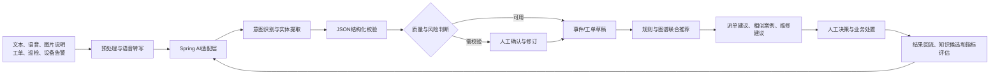

## 9.3 AI服务分层

| 层次 | 职责 |
|---|---|
| 输入适配 | 接收文本、语音转写、附件描述及结构化上下文 |
| 模型适配 | 通过Spring AI统一大模型API、参数、超时和重试 |
| 提示与结构化 | 管理场景提示模板，约束输出为指定JSON结构 |
| 业务校验 | 使用主数据、字典、规则和权限校验模型结果 |
| 人工协同 | 展示置信信息、候选值、来源和修订入口 |
| 效果评估 | 保存模型版本、输出、修订、采纳和最终结果 |

模型服务不直接连接核心业务数据库。AI适配层只接收经业务模块整理、脱敏和授权的上下文，并通过业务接口提交候选结果。

## 9.4 语义识别与事件结构化

### 9.4.1 意图体系

意图体系首批覆盖报修、投诉、咨询、建议、求助和服务咨询。意图定义、样例、同义表达和版本由AI配置管理。一个诉求可以包含主意图和附加意图。

### 9.4.2 实体体系

实体包括项目、社区、楼栋、房屋、公共区域、设备、故障类型、事件地点、时间、紧急程度、联系人和服务需求。模型输出后通过空间、设备和人员主数据进行解析与候选匹配。

### 9.4.3 结构化约束

输出采用明确Schema，包括识别结果、候选项、置信信息、缺失字段、建议追问和风险标识。校验失败时不生成正式业务数据，转为重试、补充询问或人工处理。

## 9.5 运维知识图谱设计

### 9.5.1 图谱本体

```mermaid
flowchart LR
    PROJECT["项目"] -->|包含| SPACE["空间"]
    SPACE -->|布置| DEVICE["设备"]
    DEVICE -->|发生| FAULT["故障"]
    EVENT["事件"] -->|关联| SPACE
    EVENT -->|涉及| DEVICE
    WORK["工单"] -->|处理| EVENT
    PERSON["人员"] -->|执行| WORK
    PERSON -->|具备| SKILL["技能"]
    PERSON -->|所属| ORG["组织"]
    FAULT -->|适用| PLAN["维修方案"]
    WORK -->|采用| PLAN
    PLAN -->|使用| MATERIAL["材料"]
    RISK["风险"] -->|关联| DEVICE
    RISK -->|发生于| SPACE
```

### 9.5.2 知识来源

- MySQL中的空间、设备、事件、工单、巡检和维修结构化数据；
- 经过审核的设备手册、维修规范和操作指引；
- 历史工单文本和维修记录的AI候选抽取；
- 专业人员人工录入和确认的知识。

### 9.5.3 知识生命周期

知识候选经过自动校验、重复识别和人工审核后发布。每项知识保存来源业务记录、创建方式、审核人、有效时间和版本。设备迁移、方案失效和人员变更通过业务事件触发图谱更新。

### 9.5.4 图谱存储

Neo4j保存实体节点、关系和图查询所需属性；MySQL保存知识审核、版本、来源和发布流程。图节点保留源系统类型与ID，以便追溯原始业务。

## 9.6 智能推荐机制

推荐采用“业务规则 + 图谱关系 + 语义相似 + 大模型解释”的组合方式：

1. 业务规则过滤无权限、非值班、超范围和资质不符的候选；
2. 图谱查询获取事件、空间、设备、故障、技能和历史工单关系；
3. 语义检索返回相似历史问题和处置案例；
4. 评分策略综合位置、技能、工作量、历史效果和紧急程度；
5. 大模型将结果整理为可读建议，不重新决定候选范围；
6. 人工选择、修改或拒绝，并记录原因。

派单、维修和风险推荐分别使用独立策略，避免一个综合分数掩盖业务差异。

## 9.7 人机协同设计

- AI界面同时展示原始诉求、结构化字段和可修改候选；
- 低质量、高风险或关键字段冲突时强制人工确认；
- 派单建议展示匹配技能、责任范围、值班和历史案例依据；
- 相似案例展示来源工单、时间、处置方案和结果；
- 人工修改保留修改前后值、人员和原因；
- AI服务不可用时回退到人工分类、搜索和派单；
- AI输出不得直接用于处罚、费用、责任或安全结论。

## 9.8 反馈学习闭环

系统记录模型输入摘要、模型版本、提示模板版本、结构化输出、人工修订、是否采纳和最终处置结果。研究人员在脱敏后形成样本集，用于提示模板、实体字典、规则和检索策略优化。

课题阶段原则上不在生产系统内自动更新模型权重。任何模型或提示模板升级都需离线评估、版本发布和回退方案。

## 9.9 技术选型

| 技术环节 | 建议选型 | 选型理由 |
|---|---|---|
| AI应用适配 | Spring AI | 与Spring Boot体系一致，统一模型API和结构化输出 |
| 大模型 | 合规的大模型API或企业模型服务 | 避免课题自行训练通用大模型 |
| 语音转写 | 成熟ASR服务 | 提高中文口语转写可用性 |
| 结构化输出 | JSON Schema约束 + 后端校验 | 降低自然语言输出不稳定性 |
| 图数据库 | Neo4j | 适合设备、故障、工单和人员关系查询 |
| 业务与审核数据 | MySQL | 保存来源、审核、版本和结果记录 |
| 缓存 | Redis | 缓存字典、短期会话和热点知识 |
| 异步处理 | RabbitMQ | 承载知识抽取、图谱更新和评估任务 |
| 语义检索 | 首期采用可插拔检索适配层 | 根据样本规模再决定独立向量检索组件 |

## 9.10 技术验证方案

1. 建立覆盖主要意图和关键实体的人工标注样本；
2. 区分开发、调优和最终评估样本；
3. 记录意图、实体、工单草稿和人工修订结果；
4. 选取设备故障或高频物业问题构建小范围图谱；
5. 验证相似案例、维修建议和派单建议的来源可追溯性；
6. 记录推荐展示、采纳、修改和最终处置效果；
7. 验证模型超时、输出异常和人工降级；
8. 按需求规格说明书定义的指标口径形成验证报告。

## 9.11 创新性说明

创新点不在于简单接入大模型，而在于将社区场景语义模型、业务主数据校验、运维知识图谱、规则过滤、语义检索、人工决策和结果反馈组成业务闭环，使AI能力能够在真实工单和运维过程中验证。

# 10. 系统集成设计

## 10.1 集成原则

- 明确系统边界和主数据责任，避免多系统同时维护同一主数据；
- 优先使用标准接口、事件或适配层集成，不直接操作外部系统数据库；
- 接口具备认证、版本、请求标识、幂等、超时和错误码；
- 关键数据同步具备失败重试、补偿和人工核对；
- 外部系统不可用时保留人工处理或延迟处理路径。

## 10.2 外部平台与公共服务集成

本平台按全新建设方式实施，不以既有物业系统作为前置依赖。平台内部统一建设项目、空间、居民、商户、商品服务、订单、工单及运营数据；同时预留标准接口，用于后期按合作条件接入街道、社区、12345、政务民生、养老、教育、医疗健康、公共文化及其他外部服务。

外部集成设计重点包括：

| 集成方向 | 设计重点 |
|---|---|
| 街道与社区治理 | 通知公告、政策信息、居民议事及社区事项的服务入口或数据协同 |
| 12345及民生诉求 | 按合作条件接收、转办或反馈社区相关诉求，保持事项编号和状态可追溯 |
| 政务与民生服务 | 以统一入口、链接跳转或标准接口聚合社保、就业、救助等公共服务 |
| 养老与健康服务 | 对接助餐、助洁、陪诊、养老机构、社区卫生等服务供给或预约入口 |
| 教育与公共文化 | 对接周边学校、公益课堂、图书文化和文体活动等信息与报名服务 |
| 生活公共服务 | 按条件接入水、电、燃气、通信、快递等便民服务入口 |

上述场景属于后期拓展能力，不作为当前阶段硬性开发范围。原则上采用“外部服务接入 + 平台统一入口 + 必要业务协同”的方式，不重复建设外部专业系统。

## 10.3 前端与移动端集成

居民小程序、物业端、商户或服务主体端和管理后台使用统一认证入口。不同终端调用对应场景应用接口，不直接访问数据库或编排多个底层能力。

uni-app承载居民和轻量移动作业场景；Vue 3管理端承载运营管理、配置设计、知识审核和研究分析。

## 10.4 AI服务集成

AI适配模块封装大模型和语音识别服务，向业务模块提供意图实体识别、结构化、摘要和建议等接口。外部模型只接收最小必要上下文，模型切换不影响上层业务接口。

## 10.5 支付、消息与文件集成

真实支付场景通过合规支付渠道实现支付、回调和退款；支付回调进行签名校验和幂等处理。消息中心统一路由站内消息、小程序订阅消息和短信。文件中心统一管理图片、语音和附件的元数据、权限和存储地址。

## 10.6 接口与事件规范

同步接口适用于需要即时结果的校验和命令；异步事件适用于订单完成后的统计、通知、知识抽取等后续处理。接口和事件均包含项目标识、业务标识、请求标识、版本和发生时间。

重要业务事件采用事件记录表保证本地事务提交后可重新投递，消费者根据事件ID和业务键进行幂等处理。

# 11. 安全设计

## 11.1 身份认证

管理端采用统一账号认证并支持强密码、登录限制和必要的二次验证；居民端通过手机号、微信等方式完成账号映射；服务主体和个人服务者在业务认证前先完成账号认证。

## 11.2 权限控制

系统采用基于角色的功能权限与基于项目、组织、空间和对象的数据权限组合模型。后端接口执行最终权限校验，前端菜单和按钮只用于交互提示。

关键配置发布、数据导出、知识审核、主体准入和风险处置应设置独立权限，不与普通查询权限混用。

## 11.3 数据安全

- 传输使用加密通道；
- 密码、令牌和密钥按安全规范保存；
- 身份证件、手机号等敏感信息按权限脱敏；
- 导出文件设置访问期限和操作记录；
- 数据库备份加密保存并定期验证恢复；
- 测试和研究数据原则上脱敏或匿名化。

## 11.4 接口与文件安全

接口执行认证、授权、签名或令牌校验、参数校验、限流和重放防护。文件上传校验类型、大小和安全风险；文件下载必须经过业务权限校验，不使用长期公开地址。

## 11.5 AI安全

- AI调用前执行数据最小化和必要脱敏；
- 提示模板、模型和知识库按版本管理；
- 防止用户输入覆盖系统指令或诱导越权查询；
- 模型输出经过Schema、主数据和业务规则校验；
- AI不能直接执行支付、权限、处罚和高风险设备操作；
- 保存必要的调用和人工修订审计记录；
- 外部AI不可用时降级至人工流程。

## 11.6 审计与追责

对登录、权限、配置发布、数据导出、主体审核、订单关键状态、工单完结、AI人工修订和知识发布等操作记录操作人、时间、对象、前后值和来源。审计日志与普通业务日志分开管理。

# 12. 性能与扩展设计（简版）

## 12.1 性能策略

- 普通查询使用合理索引、分页和按项目过滤；
- 项目、空间、字典和发布元数据使用Redis缓存；
- 报表、知识抽取、AI批处理和大文件任务异步执行；
- AI接口设置超时、并发限制、熔断和降级；
- 关键提交使用幂等键，避免重复预约、重复订单和重复支付；
- 性能目标值在完成用户规模和部署资源评估后确定。

## 12.2 扩展策略

- 应用按业务域划分模块，公开接口保持稳定；
- 场景差异通过业务单据、配置和插件扩展；
- 多项目数据使用项目标识和数据权限隔离；
- 公共能力不写死居民、小区和活动室等场景词；
- 当单一模块容量或团队边界达到拆分条件时，可将其独立部署；
- AI模型、语音服务和检索组件通过适配层替换。

## 12.3 容量与可用性

系统需对用户、空间、订单、工单、附件、知识节点和业务事件进行容量估算。核心业务数据定期备份，RabbitMQ消息和补偿任务防止跨模块事件丢失。具体可用性和恢复指标在部署资源及项目要求明确后确定。

# 13. 部署设计（简版）

## 13.1 部署架构

```mermaid
flowchart TB
    C["浏览器 / 小程序 / 移动端"] --> N["Nginx或统一接入层"]
    N --> A["Spring Boot模块化应用"]

    A --> M["MySQL"]
    A --> R["Redis"]
    A --> Q["RabbitMQ"]
    A --> G["Neo4j"]
    A --> F["对象存储/文件服务"]
    A --> X["大模型API/语音识别服务"]

    A --> O["日志与监控"]
    M --> B["备份存储"]
    G --> B
```

## 13.2 环境规划

至少设置开发、测试和生产环境。模型提示、流程、规则和场景模板配置通过版本化发布包在环境间迁移，不直接复制生产数据。测试环境使用脱敏数据。

## 13.3 应用部署

首期将Spring Boot各业务模块部署为一个或少量容器实例，MySQL、Redis和Neo4j作为逻辑独立基础组件部署；RabbitMQ仅在启用可靠异步事件或AI异步任务时部署。根据现场资源，可采用云环境或项目私有环境；AI服务根据数据安全评审选择外部API或企业内部模型服务。

## 13.4 配置与密钥

环境配置与应用代码分离。数据库密码、支付密钥、AI访问密钥和消息凭证通过安全配置方式注入，不写入代码仓库或普通日志。不同环境使用独立密钥。

## 13.5 备份与恢复

定期备份MySQL业务与配置数据、Neo4j知识数据和关键文件元数据。发布前对重要配置和数据进行备份。项目上线前执行恢复演练，确认业务、知识和配置版本能够一致恢复。

## 13.6 轻量化部署约束

课题首期不引入Kubernetes、服务网格、分布式数据库、多活集群或独立大数据平台。开发和试点环境允许在满足资源隔离和备份要求的前提下，将应用及基础组件部署在少量服务器或容器主机中。

MySQL、Redis、Neo4j以及按需启用的RabbitMQ属于逻辑独立组件，不代表必须分别采购服务器。只有在真实业务量、可用性要求或企业基础设施标准明确提出需要时，才增加高可用集群、读写分离或独立服务部署。

# 14. 日志与监控（简版）

## 14.1 日志分类

| 日志类型 | 主要内容 |
|---|---|
| 访问日志 | 请求标识、接口、用户、响应状态和耗时 |
| 应用日志 | 业务处理、异常和外部调用信息 |
| 审计日志 | 权限、配置、数据导出、审核和关键状态变化 |
| 事件日志 | 事件产生、投递、消费、重试和失败 |
| AI日志 | 模型版本、提示版本、耗时、结构化结果和人工修订 |
| 知识日志 | 知识抽取、审核、发布、失效和图谱同步 |

日志不得记录明文密码、完整令牌、支付密钥和不必要的个人敏感信息。

## 14.2 运行监控

监控应用健康、接口响应、数据库连接、Redis、Neo4j状态、文件服务、AI调用成功率和外部接口可用性；启用RabbitMQ时增加消息积压监控。首期可采用Spring Boot Actuator结合Prometheus和Grafana，或复用企业现有监控平台。

## 14.3 告警与补偿

对应用不可用、接口错误率升高、消息积压、支付回调失败、事件重试超限、AI持续超时、知识同步失败和存储容量不足等情况设置告警。告警应指向明确责任人并支持确认和关闭。

## 14.4 研究指标监控

单独记录配置发布、模板复用、AI识别、人工修订、推荐采纳、知识覆盖和场景运行指标，为课题阶段评估提供可追溯证据。

# 15. 测试与验证设计（简版）

## 15.1 测试范围

- 单元测试：领域规则、金额、状态流转和数据权限；
- 模块测试：身份、空间、订单、任务、配置和AI适配；
- 集成测试：物业系统、支付、消息、文件和AI服务；
- 流程测试：商城购物、社区团购、服务预约、空间预约、活动报名和工单；
- 安全测试：越权、敏感数据、接口、文件和AI提示注入；
- 性能测试：典型查询、提交、事件、报表和AI并发；
- 恢复测试：数据库、配置版本、消息补偿和备份恢复。

## 15.2 创新点一验证

以多个典型场景验证模型、表单、流程、规则、权限和模板装配；记录配置完成时间、代码扩展、公共能力复用、模板复制、版本发布和回滚结果；在办公楼或公寓模拟项目中验证空间、身份和服务目录替换。

## 15.3 创新点二验证

以人工标注样本测试意图识别和实体提取；以受控工单测试事件草稿、派单建议和相似案例；以设备故障或高频问题验证图谱来源、关系查询和知识更新；测试模型异常和人工降级。

## 15.4 场景验收

| 场景 | 验收重点 |
|---|---|
| 居民诉求与工单 | 原始输入、结构化、人工确认、流转和闭环完整 |
| 商城购物 | 商品快照、库存、订单、支付、配送/自提/核销、积分及退款协同正确 |
| 社区团购 | 团购规则、开团/参团、成团/失败、订单、退款、履约及积分协同正确 |
| 服务预约 | 业务单据与订单分离、支付事件、家庭代办、履约和积分协同正确 |
| 空间预约 | 时段冲突、审核、收费、核销和释放正确 |
| 活动报名 | 免费与付费分流、多人报名和名额释放正确 |
| 模板复制 | 新项目配置可运行且差异可追溯 |
| AI与知识 | 输出可校验、建议可追溯、人工决策有记录 |

## 15.5 验证证据

验证过程应保留需求与测试用例对应表、配置版本、发布记录、接口或事件记录、测试数据、指标结果、问题整改和用户反馈。量化目标值在样本基线和评审确认后纳入正式验收标准。

## 15.6 任务书研究内容的设计验证

| 任务书重点 | 设计承接 | 验证结果形式 |
|---|---|---|
| 统一平台架构、核心业务中台与“人、房、事、物、组织”模型 | 第2—6章 | 分层架构、五项中台边界、统一身份与空间模型、数据关系和运行数据 |
| 模型驱动与低代码动态装配 | 第5、7、8章 | 能力注册、场景配置、模板复制、版本发布和回滚记录 |
| 多业态能力复用 | 第2.8、3.6、8.6和8.9节 | 社区与办公楼或公寓模拟项目差异分析 |
| AI语义识别 | 第7.1、9.2—9.4节 | 标注样本、结构化结果和人工修订记录 |
| 运维知识图谱 | 第6章、第9.5节 | 图谱本体、知识来源、审核和关系查询 |
| 智能派单与协同处置 | 第7.1、第9.6—9.8节 | 推荐依据、人工采纳和处置效果 |
| 巡检、设备告警和维修数据融合 | 第6.2、第9.5、第10.2节 | 数据映射、知识抽取和案例关联 |
| 大光路应用验证和成果推广 | 第15章、第16章 | 场景测试、指标报告、平台版本和课题成果 |

# 16. 实施规划

## 16.1 第一阶段：需求基线与总体设计

主要工作：

- 完成业务调研、需求规格和概要设计；
- 明确平台全新建设范围、外部服务边界及后续接口预留；
- 明确大光路首批验证场景；
- 建立统一术语、主数据和指标口径；
- 确认AI数据、支付和安全边界。

阶段成果包括需求规格说明书、概要设计说明书、总体架构和验证计划。

## 16.2 第二阶段：平台基础与核心运营能力

主要建设统一身份权限、空间基础模型、模型元数据、消息文件等平台基础能力，以及运营主体、商品服务、交易订单、任务履约和计费支付结算五项核心业务中台；同步建设积分账户、积分规则、积分流水、抵扣和兑换等基础运营激励能力。

优先打通商户入驻与商品/服务发布、社区商城购物、社区团购、社区服务预约、空间预约和活动报名等核心运营闭环，并建设必要的居民报修与工单基础能力。该阶段重点验证商城、团购、服务等不同场景对统一主体、商品服务、订单、支付和积分能力的复用方式。

## 16.3 第三阶段：模型驱动与低代码能力

建设模型元数据、动态表单、Flowable流程、轻量规则、场景模板、配置发布和回滚能力；将前期场景逐步迁移至配置驱动；建立办公楼或公寓模拟项目并开展复制验证。

## 16.4 第四阶段：AI语义识别

建立意图和实体体系、标注样本、AI适配层和结构化输出校验，完成居民报修、投诉和咨询的事件草稿及人工确认功能，形成初步效果评估。

## 16.5 第五阶段：运维知识图谱与智能协同

选择核心设备或高频物业问题建设图谱本体和知识审核流程，接入工单、巡检和维修数据，形成相似案例、派单建议和风险提示。

## 16.6 第六阶段：系统集成与大光路验证

在大光路实际场景中完成系统集成、用户试用、指标采集、问题整改和运行优化；验证物业服务、运营场景、模型复制和AI协同的实际效果。

## 16.7 第七阶段：成果总结与验收

整理平台正式版本、软件著作权材料、论文研究数据、综合研究报告和课题验收证据，形成智慧社区数字化运营整体解决方案及后续推广建议。

## 16.8 年度对应关系

| 年度 | 重点任务 | 主要成果 |
|---|---|---|
| 2026年 | 总体方案、平台架构、商城/团购/服务等核心运营能力、积分体系、平台基础能力和模型驱动初步验证 | 平台基础版本、核心运营闭环、总体方案、设计文档和阶段成果 |
| 2027年 | AI语义识别、知识图谱、系统集成、大光路验证和成果总结 | 平台正式版本、AI协同模块、研究报告、软著及论文等 |

## 16.9 实施控制

- 以需求基线和阶段评审控制范围；
- 每阶段选择可运行场景验证，不以模块数量代替成果；
- 公共能力、配置能力和AI能力同步形成测试与研究证据；
- 对外部接口、数据、安全和AI模型依赖建立风险清单；
- 重大技术选型和验收阈值在概要设计评审后确认。

---

本文件为课题开题阶段概要设计。数据库字段、接口参数、代码结构、页面交互、算法提示模板和部署资源规格在后续详细设计或专项方案中进一步明确。
